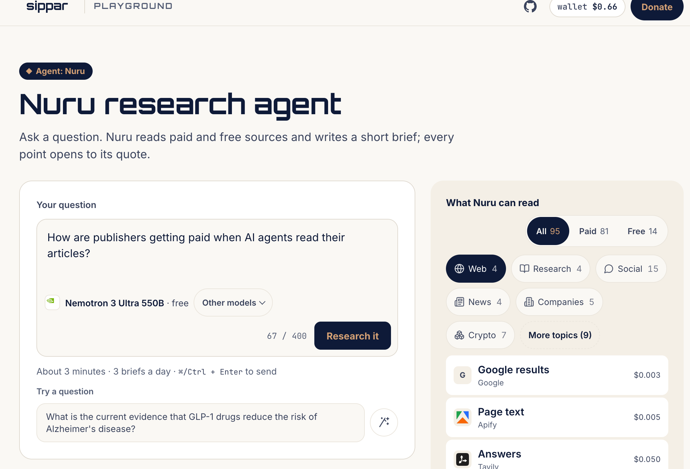
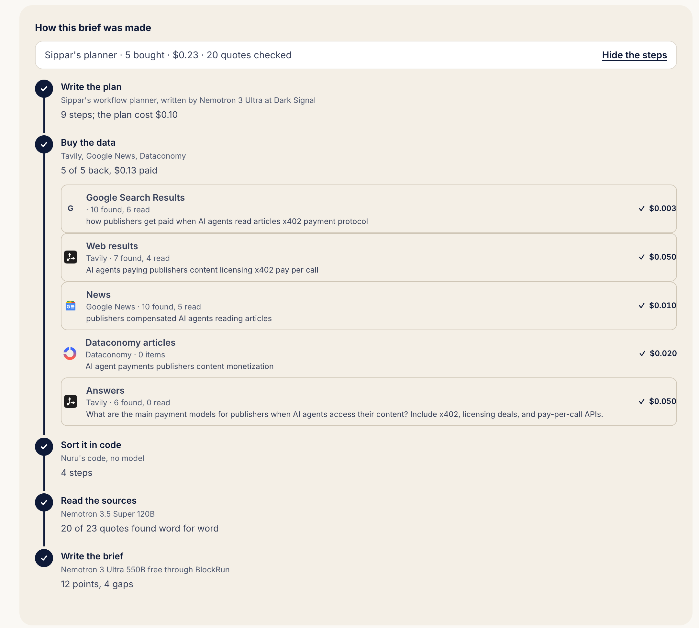
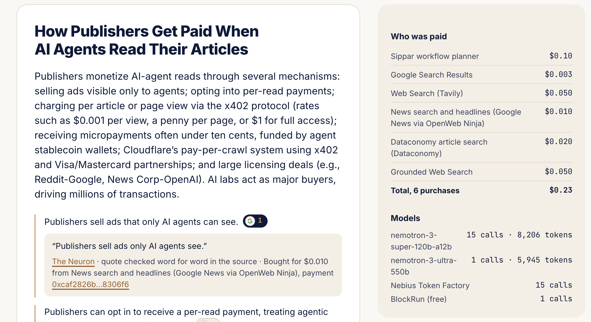

# Nuru

Nuru is an agent that answers a question about a market with a short brief where every point
opens to its quote, its source and its payment. It plans with NVIDIA Nemotron on Nebius Token
Factory and pays for each source per call, from the chat app you already use or from its own page.

**For:** a founder sizing a market, an analyst checking who buys, anyone who needs sourced answers
for a few cents without signing up for each data source.

**Proof:** on Nuru's own page, Nemotron on Token Factory planned, bought and read a job for $0.11,
and all 18 of its quotes were found word for word in what it paid for. Try it at
https://agent.sippar.network.

**Nuru and Sippar:** Nuru is the agent, built for the Nebius x NVIDIA Global AI Hackathon (Best
Apps and Agents track). Sippar is the payment rail it pays through; it existed before the
hackathon, and Nuru calls its public endpoints the way any agent can. The judged version is the
tag `devpost-submission-2026-10-30`.



*A question in plain words. Nemotron is the default model; the menu shows each source and its price.*



*How the brief was made: the plan, each purchase with its price, and how many quotes were found word for word.*



*Every point opens to its quote, its source and its payment. Who was paid, and the Nemotron calls on Nebius Token Factory, sit beside the brief. Run of 13 November 2026, $0.23.*


## How it works

- **The model.** NVIDIA Nemotron by default, or any model you pick. From a harness, Sippar's door
  buys it per call on AntSeed; Nuru's own runtime in this repo runs it on Nebius Token Factory, or free
  on BlockRun's Nemotron 3 Ultra with no account.
- **Pay per call.** With x402, a service answers "402 Payment Required", Nuru pays in USDC on Base
  and gets the data. Never past its budget.
- **The plan.** Nemotron plans the job over a live catalog of services and their prices, and code
  checks every step before anything is paid.
- **Search.** Tavily, bought per call. Tavily's keyless pay-per-search is the design target; during
  the build those calls settled through a reseller of Tavily search, and each response names the
  path that served it.
- **The publishers.** Each Tavily search sends a share to the publishers whose pages appear in
  its results. Any publisher can be paid this way, into a wallet created for the publisher's email
  that only they can open, before they have signed up with anyone. The first payment reached
  Dataconomy on 30 October 2026.
- **Any harness.** ChatGPT, Claude, Hermes Agent in NVIDIA's NemoClaw sandbox on Nebius, or Nuru's
  own page at https://agent.sippar.network.

Nuru calls Sippar's public endpoints the way any agent can. Sippar, the payment rail, existed
before the hackathon, and its catalog is one choice: Nuru plans over any marketplace that
publishes a catalog and pays whatever a seller's 402 names.

## Run it in your harness

1. Add the MCP server `https://sippar.network/mcp/protocol/pay` to ChatGPT, Claude or Hermes Agent
   ([skills/sippar-connect](skills/sippar-connect/SKILL.md)).
2. Get a Sippar Unlock card, paid by card through Stripe, at https://sippar.network/unlock. Sign
   in once and redeem its code ([skills/sippar-pay](skills/sippar-pay/SKILL.md)). The card is the
   run's hard cap.
3. Ask for the job, for example "find the audience for Nebius AI Cloud"
   ([skills/sippar-workflows](skills/sippar-workflows/SKILL.md)).

## Run Nuru's own runtime (Nemotron, free or on Nebius Token Factory)

Requirements: Node.js 22 and a wallet on Base holding a few dollars of USDC. Every read is bought per
call. The model needs no key: with none set, Nuru runs on BlockRun's free NVIDIA Nemotron 3 Ultra.
Free comes first: the Ultra calls (plan, write) try BlockRun's free Ultra, then Token Factory, then
OpenRouter (`NEMOTRON_PROVIDERS`, default `blockrun,tokenfactory,openrouter`). The Super calls (reading
each source) try Token Factory first, since BlockRun has no free Super (`NEMOTRON_PROVIDERS_SUPER`, default
`tokenfactory,openrouter,blockrun`). OpenRouter's free Nemotron needs `OPENROUTER_API_KEY`. The page
shows which provider served each run.

```bash
npm install
export NEBIUS_API_KEY=...        # optional: Token Factory for the Super calls and as Ultra's fallback
export AGENT_WALLET_KEY=0x...    # the agent's own Base wallet, funded with USDC
npm start                        # http://localhost:8790
```

Or from the command line:

```bash
node cli.mjs "How are publishers getting paid when AI agents read their articles?" "a publisher"
```

Tests: `npm test` (the plan check, the free sources against recorded answers, and the page's daily limits; no key, nothing bought).

Settings: `MAX_SPEND_USD` (per-run ceiling, default 0.50), `PLANNER` (`catalog`, the default, or
`fixed`), `CATALOG_URL` (any marketplace's catalog; Sippar's free catalog by default),
`PLANNER_MODEL`, `WORKER_MODEL`, `WRITER_MODEL`, `TOKEN_FACTORY_BASE_URL`, `MAX_STEPS`, `MAX_DOCS` (documents read per brief, spread across the steps), `FREE_MIN_TOKENS` (the least room a free Nemotron route gets to reason and answer, default 16000).
On the page: `RUNS_PER_IP_PER_DAY` (default 3) and `DAILY_SPEND_USD` (spend shared by every
visitor, default 1), counted per UTC day.

Free public sources: `FREE_SOURCES=on` adds 14 free public data sources to the catalog at $0 (OpenAlex,
Crossref, arXiv, SEC EDGAR, openFDA drug recalls, USGS earthquakes, NASA POWER, World Bank, GBIF,
Wikipedia, npm, Open Library, CoinGecko, DefiLlama). Nuru calls them directly, credits each one under
the brief, and writes an empty search as a gap, never as a fact. `FREE_API_CONTACT` (an email) goes in
the User-Agent; SEC EDGAR refuses calls without one, so it stays off until it is set.
`FREE_CALLS_PER_RUN` (default 10), `FREE_FOR_EACH_MAX` (5), `FREE_CALLS_PER_DAY` (300, across all visitors).

## Inside NVIDIA's sandbox on Nebius

[harness/nemoclaw](harness/nemoclaw/README.md): the NemoClaw policy, the Hermes profile and the
VM setup script that ran Hermes Agent in NVIDIA OpenShell on a Nebius AI Cloud VM on 29 October
2026, with Nemotron 3 Super on Token Factory as its model.

## Files

- `lib/agent.mjs`: one run: plan, buy, read, write, account
- `lib/planner.mjs`, `lib/catalog.mjs`: the plan format, the code check, the catalog
- `lib/free.mjs`: the free public sources, each with its endpoint, limits, credit and result shape
- `lib/tf.mjs`: Nemotron from the first provider that answers (Token Factory, BlockRun free, OpenRouter free)
- `lib/pay.mjs`, `lib/tools.mjs`: x402 payments and the fallback source list
- `server.mjs`, `public/`: the page; `cli.mjs`: the command line
- `skills/`: any harness on the same door

## License

MIT
